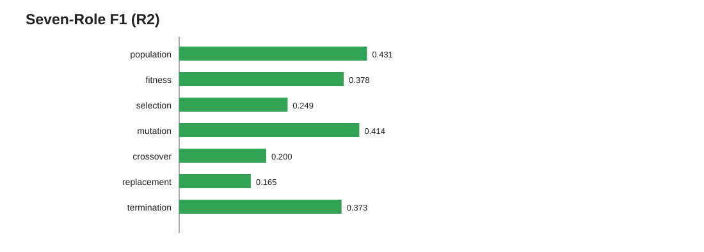

# EvoSafe

EvoSafe is a Python **static-analysis toolkit** that decides whether a piece of Python source looks safe to run, and — optionally — recognises the structure of **evolutionary algorithms (EAs)** inside it. It inspects source code only; it never imports or executes the program it analyses.

It combines three safety analyses (taint, capabilities, resource risk) into a rule-based verdict (`SAFE`, `CONDITIONALLY_SAFE`, `UNSAFE`), serialises everything into a deterministic **Safety IR** (a JSON, compiler-style intermediate representation), and can attach an **EA-role inference** layer that labels seven structural roles: population, fitness evaluation, selection, mutation, crossover, replacement and termination.

## Results at a glance

Evaluated on the frozen Review 2 dataset: **936 reviewed programs, 0 analysis failures**, dataset SHA-256 `c40f92f8…8680082`. Full tables: [docs/RESULTS.md](docs/RESULTS.md).

| Question | Result | How to read it |
|---|---|---|
| Does it run on everything? | 936 / 936 analysed, 0 failures | Mean 14 ms, median 8 ms, p95 44 ms, max 261 ms per program |
| Safety verdict accuracy (programs with a determinate label) | **107 / 109 = 0.982** | Only 109 programs carry a SAFE / UNSAFE / CONDITIONALLY_SAFE ground truth |
| UNSAFE detection | precision **1.000**, recall **0.985** (66 TP, 0 FP, 1 FN) | One unsafe program was missed (predicted SAFE) |
| SAFE detection | precision **0.971**, recall **0.971** (34 TP, 1 FP, 1 FN) | The FP is that same missed unsafe program; the FN is one SAFE program flagged `CONDITIONALLY_SAFE` |
| Does EA inference change safety verdicts? | **0 / 936** verdicts change | EA inference is enrichment only, verified on every program |
| EA-role inference (7 roles, all 936 programs) | macro precision **0.572**, recall **0.252**, F1 **0.316** | Precise but conservative: it misses many roles it should find |



### What the results do and do not show

**They support:** a working proof of concept. Every program is analysed in milliseconds, the safety rules separate unsafe from safe code on the labelled cases with no false `UNSAFE` on safe programs, and the EA layer produces differentiated, evidence-backed role findings without influencing the safety verdict.

**They do not support:** broad safety assurance or production readiness.

- **Most ground truth is `UNKNOWN`.** 827 of 936 programs (the legacy benign / DEAP / PyGAD / mealpy / pymoo corpus) have no individually adjudicated safety label, so safety accuracy is established only on the 109 determinate cases. The tool gave all 827 a verdict (447 `SAFE`, 194 `UNSAFE`, 186 `CONDITIONALLY_SAFE`) but those verdicts are not scored.
- **EA recall is the main weakness.** Replacement (recall 0.094), crossover (0.122) and selection (0.158) are the weakest roles. The error analysis (1,328 role errors: 361 false positives, 967 false negatives) traces most misses to indirect data flow — rebinding, slices, helper-returned collections — and most false positives to ordinary comprehensions and non-EA code that merely looks like EA code. See [docs/RESULTS.md](docs/RESULTS.md#ea-role-error-analysis).
- **Numbers from different benchmarks are not comparable.** The 18-program development set scores 1.000 because it was used to tune the detectors; the 51-program held-out v1 set scores 0.640 macro-F1 (6 roles); the 936-program Review 2 set scores 0.316 (7 roles). These are different data, not a paired before/after.
- **Duplicates exist.** 3 exact-duplicate source groups and 116 near-duplicate pairs (token similarity ≥ 0.90) are recorded and retained, which can reduce the independence of examples.

A `SAFE` verdict is the outcome of configured rules and evidence. It is not a proof that arbitrary Python code is harmless.

## Capabilities

- **AST parsing** — parse Python source and serialise the syntax tree.
- **Control-flow graphs** — module or per-function CFGs with basic blocks and edges.
- **Taint analysis** — trace selected sources toward sensitive sinks.
- **Capability analysis** — filesystem, network, process and dynamic-execution signals with severity.
- **Resource estimation** — heuristic risk from loops, recursion and call depth.
- **Safety decision** — combines taint, capability and resource reports, with optional policy hooks.
- **Safety manifest** — deterministic summary with a digest and rejection reasons.
- **Safety IR** — functions, loops, capabilities, CFG, taint flows, evidence and the decision as JSON.
- **EA-role inference (opt-in)** — population, fitness, selection, mutation, crossover, replacement, termination, with candidate lineage and evidence. Never an input to the safety verdict.
- **Sandboxed execution orchestration** — execution gated on static validation, via subprocess or Docker backends with configured limits. This is an execution facility, not a hardened security boundary.

## Quick start

```bash
git clone https://github.com/SwarnaDharshiniS/EvoSafe.git
cd EvoSafe
python3 -m pip install -r requirements.txt   # networkx
python3 -m unittest discover -s tests         # 412 pass, 4 skipped (see below)
python3 examples/api_quickstart.py
```

Python 3.12 is the recommended runtime; the suite and the Review 2 reproduction have also been run on 3.13. EvoSafe uses repository-local modules rather than an installable package, so run everything from the repository root.

### Command line

```bash
python3 main.py ast --src "answer = 40 + 2"
python3 main.py cfg path/to/program.py --function calculate
python3 main.py taint --src "import os; os.system(input())"
python3 main.py caps path/to/program.py --json
python3 main.py resource path/to/program.py --json
python3 main.py manifest path/to/program.py --json
python3 main.py safety-ir path/to/program.py
```

| Command | Purpose | Output |
|---|---|---|
| `ast` | Parse source and serialise the AST | JSON |
| `cfg` | Module CFG, or one function with `--function NAME` (`*` for all) | JSON |
| `taint` | Supported source-to-sink data flows | Summary or JSON (`--json`) |
| `caps` | Capability signals and severity | Summary or JSON |
| `resource` | Resource metrics and heuristic flags | Summary or JSON |
| `manifest` | Deterministic safety manifest | Summary or JSON |
| `safety-ir` | Structured Safety IR document | JSON |

Every command accepts a file path or an inline `--src` string. `manifest` and `safety-ir` accept `--analysis-version` and `--timestamp`; without a timestamp they use a fixed epoch value so output is deterministic.

### Python API

```python
from analysis.safety_ir import build_safety_ir_from_source, safety_ir_to_json
import json

source = open("examples/review_ea_program.py").read()
ir = json.loads(safety_ir_to_json(
    build_safety_ir_from_source(source, source_name="sample.py", include_ea=True)
))
print(ir["decision"]["verdict"])
print({name: role["detected"] for name, role in ir["ea_roles"]["roles"].items()})
```

> **Two entry points, one difference.** `build_safety_ir_from_source` (and the `safety-ir` command) applies the default *external-access policy*, so programs that touch the filesystem or network come back `CONDITIONALLY_SAFE`. `analysis.pipeline.analyze_program` runs the same analyzers but applies **no policy unless you pass one**, so the same program returns `SAFE`. On the Review 2 corpus the two disagree on 87 of 936 programs, all `CONDITIONALLY_SAFE` vs `SAFE`. **The reported results use the Safety IR entry point.**

More examples: [examples/api_quickstart.py](examples/api_quickstart.py), [examples/quickstart.ipynb](examples/quickstart.ipynb), and saved CLI output for two sample programs in [examples/outputs/](examples/outputs/).

## Verdict semantics

Severity is ordered `SAFE` < `CONDITIONALLY_SAFE` < `UNSAFE`. Taint findings and dynamic-execution signals can produce `UNSAFE`; high-risk unbounded resource patterns can too, while other unbounded-resource findings require review. Policies can make a result conditional or unsafe. Always read the evidence, rule hits and reasons rather than treating the verdict as a proof.

EA inference reports structural roles. Confidence describes strength of structural evidence, not a probability. Dynamic or unresolved flows may remain undetected.

## Repository layout

| Path | Contents |
|---|---|
| `main.py` | CLI entry point |
| `parser/` | Python source and notebook parsing |
| `cfg/` | Control-flow graph construction |
| `analysis/` | Taint, capability, resource, decision, manifest, Safety IR, pipeline, EA inference |
| `sandbox/` | Validation-gated execution orchestration and scheduling |
| `dataset/` | Frozen `review-2.0` dataset, lock file, manifest and validation report |
| `evaluation/` | Review 2 results, metrics, error analysis, plots, and the earlier EA benchmark and corpus summaries |
| `scripts/` | `reproduce_r2.py`, benchmark and corpus evaluators, `fetch_python_tree.sh` |
| `examples/` | API quickstart, notebook, sample programs and their CLI outputs |
| `tests/` | Unit and integration tests |
| `docs/` | [Architecture](docs/architecture.md), [implementation guide](docs/implementation_guide.md), [results](docs/RESULTS.md), [dataset](docs/DATASET.md) |

## Dataset

`dataset/` holds 1,114 Python programs in eight categories; 936 are reviewed and locked for evaluation, 178 unreviewed programs are excluded. Each reviewed program has a `.metadata.json` with its expected safety label, seven EA-role labels and a written ground-truth reason. Details, label counts, provenance and the freeze procedure are in [docs/DATASET.md](docs/DATASET.md).

## Known limitations

- Static analysis is approximate; rules cover a defined set of sources, sinks and capabilities.
- Safety accuracy is established on 109 determinate programs only; 827 labels are `UNKNOWN`.
- EA-role recall is low (macro 0.252), especially for replacement, crossover and selection.
- Python only; dynamic features (aliasing, callbacks, `getattr`-style dispatch) can hide flows.
- Execution orchestration is not a hardened sandbox. Do not run untrusted code outside a properly isolated environment.

## Documentation

- [docs/RESULTS.md](docs/RESULTS.md) — all tables, confusion matrix, per-category results, error analysis
- [docs/DATASET.md](docs/DATASET.md) — taxonomy, labels, provenance, freeze and duplicates
- [docs/architecture.md](docs/architecture.md) — pipeline, module boundaries, trust boundaries
- [docs/implementation_guide.md](docs/implementation_guide.md) — file-by-file implementation walkthrough
